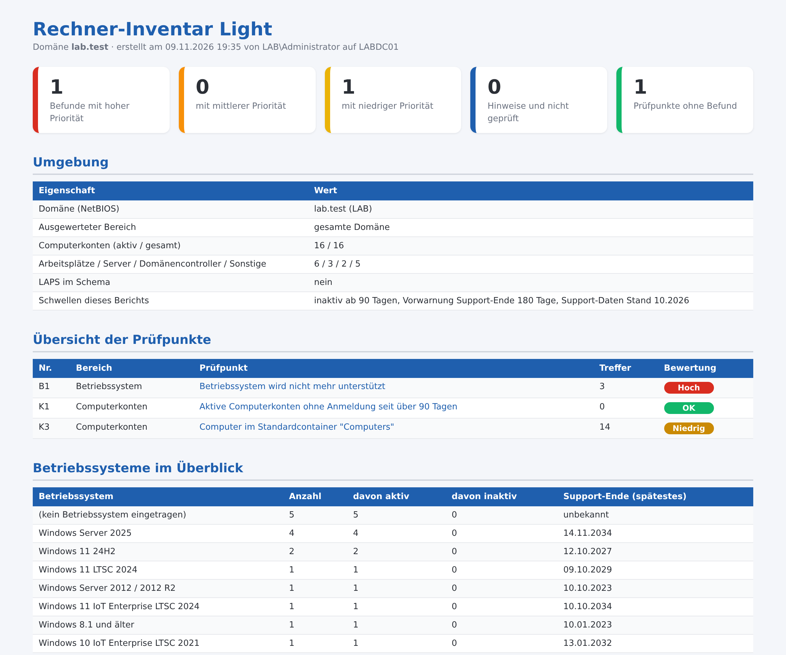

# Rechner-Inventar Light – Computerkonten und Support-Ende im Active Directory

Kostenloses PowerShell-Skript: prüft alle Computerkonten mit Betriebssystem, Version, Support-Ende und letzter Anmeldung in **3 Punkten** und erzeugt einen übersichtlichen **HTML-Bericht auf Deutsch**. Es arbeitet **ausschließlich lesend**: Es ändert nichts, legt nichts an und überträgt keine Daten.



Der gezeigte Bericht stammt aus einer Testdomäne. Das vollständige Beispiel liegt als [Beispielbericht.html](Beispielbericht.html) bei.

## Was geprüft wird

| Nr. | Bereich | Prüfpunkt |
|---|---|---|
| B1 | Betriebssystem | Betriebssystem wird nicht mehr unterstützt |
| K1 | Computerkonten | Aktive Computerkonten ohne Anmeldung seit über N Tagen |
| K3 | Computerkonten | Computer im Standardcontainer "Computers" |

Jeder Befund kommt mit Erklärung und Empfehlung.

## Start

```powershell
powershell -ExecutionPolicy Bypass -File .\Rechner-Inventar-Light.ps1
```

Alle Optionen zeigt `Get-Help .\Rechner-Inventar-Light.ps1 -Detailed`. Voraussetzungen und Rechte stehen im Kopf des Skripts. Getestet mit Windows Server 2019, 2022 und 2025 in Testdomänen (deutsches Windows).

## Vollversion

Die Light-Version enthält 3 von 12 Prüfpunkten (25 %). Die **Vollversion** prüft zusätzlich unter anderem:

- Support endet in den nächsten N Tagen
- Betriebssystem nicht bewertet
- Evaluierungsversionen
- Deaktivierte Computerkonten
- Rechner ohne LAPS-Kennwort
- LAPS-Kennwort seit über 30 Tagen abgelaufen
- Rechner mit altem Kontokennwort trotz aktueller Anmeldung
- Von normalen Benutzern in die Domäne aufgenommene Rechner
- Jeder Benutzer darf Rechner in die Domäne aufnehmen

➜ **[Vollversion auf Gumroad](https://mueller86.gumroad.com/l/zzycdd)** · **[Vollversion auf Etsy](https://www.etsy.com/listing/4593088535)** · **[alle Prüfskripte im Shop](https://www.etsy.com/shop/ITAdminToolsbyMM)**

## Weitere kostenlose Prüfskripte

- [AD-Schnellcheck](https://github.com/jackyno7/ad-schnellcheck) (8 Prüfpunkte zur Domäne)
- [Anmelde Sperrbericht Light](https://github.com/jackyno7/anmelde-sperrbericht-light)
- [Berechtigungsbericht Light](https://github.com/jackyno7/berechtigungsbericht-light)
- [Dateiserver Bericht Light](https://github.com/jackyno7/dateiserver-bericht-light)
- [GPO Bericht Light](https://github.com/jackyno7/gpo-bericht-light)
- [Kerberos Altlasten Check Light](https://github.com/jackyno7/kerberos-altlasten-check-light)
- [DNS DHCP Bericht Light](https://github.com/jackyno7/dns-dhcp-bericht-light)
- [DC Gesundheitsbericht Light](https://github.com/jackyno7/dc-gesundheitsbericht-light)

## Hinweise

- Der Bericht enthält Konto-, Rechner- oder Servernamen – bitte vertraulich behandeln.
- Der Bericht zeigt Auffälligkeiten anhand fester Regeln. Er ersetzt keine Sicherheitsprüfung und erhebt keinen Anspruch auf Vollständigkeit.
- Nutzung auf eigene Verantwortung, siehe [LICENSE](LICENSE).
- Bei der Ausarbeitung wurden KI-Werkzeuge unterstützend eingesetzt; Inhalte und Skript wurden fachlich geprüft und im Testlab getestet.

---

### English

Free, read-only PowerShell script that inventories all computer accounts with operating system, support end date and last logon (3 checks, German HTML report with findings and recommendations). No changes are made and no data leaves the machine. Run: `powershell -ExecutionPolicy Bypass -File .\Rechner-Inventar-Light.ps1`. The full version with 12 checks: https://mueller86.gumroad.com/l/zzycdd
